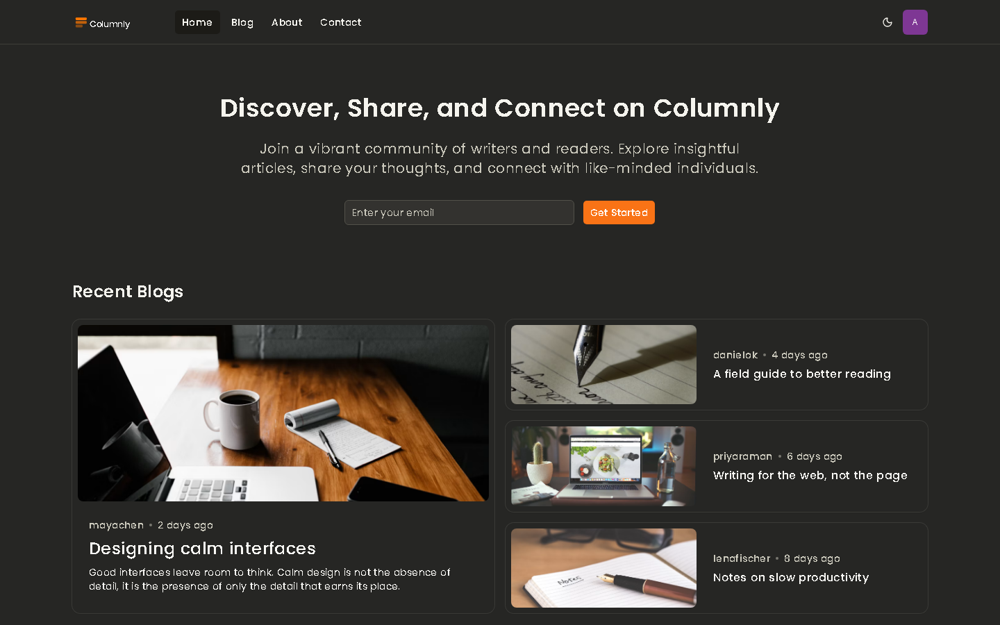
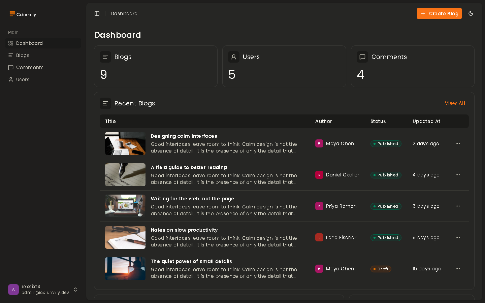
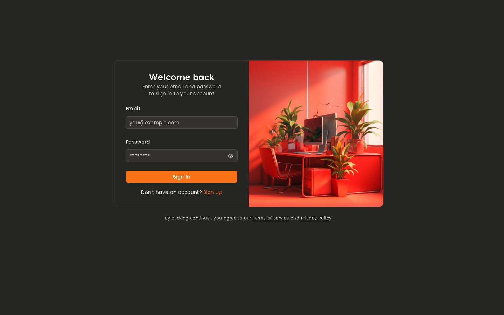
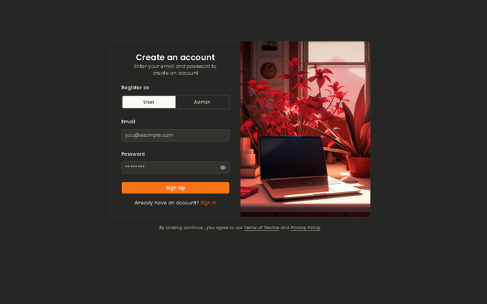
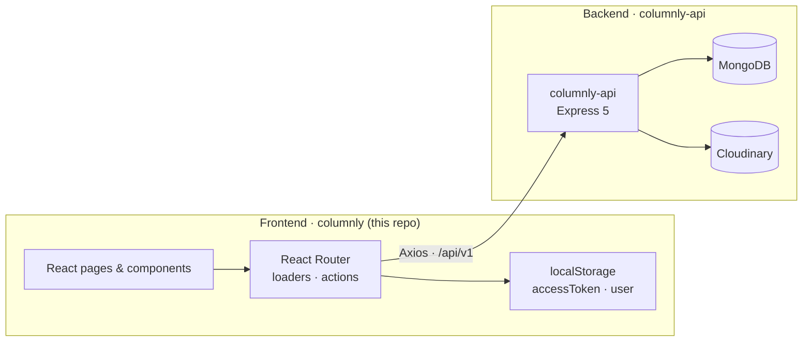

<div align="center">

<picture>
  <source media="(prefers-color-scheme: dark)" srcset="src/assets/columnly-navbar-dark.svg">
  
</picture>

# Columnly

**Discover, share, and connect — a full-stack blogging platform for writers, readers, and editors.**

[](https://react.dev/)
[](https://www.typescriptlang.org/)
[](https://vite.dev/)
[](https://tailwindcss.com/)
[](LICENSE)
[](#contributing)

[Frontend](https://github.com/RexSixT9/columnly-frontend) · [API](https://github.com/RexSixT9/columnly-api) · [Report a bug](https://github.com/RexSixT9/columnly-frontend/issues) · [Request a feature](https://github.com/RexSixT9/columnly-frontend/issues)

</div>

---

## Table of Contents

- [About](#about)
- [Screenshots](#screenshots)
- [Features](#features)
- [Tech Stack](#tech-stack)
- [Architecture](#architecture)
- [Project Structure](#project-structure)
- [Routes](#routes)
- [Getting Started](#getting-started)
- [Environment Variables](#environment-variables)
- [Available Scripts](#available-scripts)
- [Connecting to the API](#connecting-to-the-api)
- [Deployment](#deployment)
- [Troubleshooting](#troubleshooting)
- [Contributing](#contributing)
- [License](#license)
- [Acknowledgements](#acknowledgements)

## About

Columnly is a modern blogging platform where readers discover articles and editors publish them from a dedicated admin dashboard. The project is split into two repositories:

| Repository | Stack | Purpose |
| --- | --- | --- |
| **columnly-frontend** (this repo) | React 19 · TypeScript · Vite · Tailwind CSS 4 | Public site and admin dashboard |
| **[columnly-api](https://github.com/RexSixT9/columnly-api)** | Express 5 · TypeScript · MongoDB · Mongoose | REST API, authentication, storage |

The frontend is a single-page application that talks to the API over `/api/v1`. It uses React Router data APIs (`loaders` and `actions`) for data fetching and mutations, keeps the short-lived access token in `localStorage`, and relies on an HTTP-only refresh cookie to renew sessions.

## Screenshots

<div align="center">

**Home — signed-in view**



<br><br>

**Admin dashboard — signed-in editor view**



</div>

<table>
  <tr>
    <td width="50%">
      
      <p align="center"><sub><strong>Sign in</strong> — split-screen auth with artwork and dark theme</sub></p>
    </td>
    <td width="50%">
      
      <p align="center"><sub><strong>Create an account</strong> — reader or whitelisted admin registration</sub></p>
    </td>
  </tr>
</table>

> All screenshots were captured at 1440 × 900 in dark mode and live in [`docs/screenshots`](docs/screenshots). The home and dashboard views show a signed-in session.

## Features

### For readers

- 🏠 **Landing page** with an animated hero, recent articles, and a full blog feed.
- 📚 **Blog listing and detail pages** with rich-text content, reading-time estimates, and responsive banners.
- 🔍 **Article metadata** — author, publish date, likes, and comment counts.
- 🔗 **Share menu** for Facebook, X/Twitter, and LinkedIn, plus copy-link to clipboard.
- 💬 **Engagement counters** — like and comment counts are shown on every article.
- 🌗 **Dark / light theme** that follows the user's preference.
- 📱 **Fully responsive** layouts and an accessible, keyboard-friendly UI.

### For authenticated users

- 🔐 **Sign up and sign in** with email and password.
- 👤 **Profile settings** — update username, email, first/last name, and password.
- 🔁 **Session refresh** without re-entering credentials, powered by HTTP-only cookies.
- 🚪 **Sign out** from the sidebar or navigation menu.

### For administrators

- 📊 **Dashboard** with totals for blogs, users, and comments, plus recent activity feeds.
- ✍️ **Blog management** — create, edit, and delete posts from a data table.
- 🖊️ **Rich editor** built with Tiptap, with a formatting toolbar and Markdown-compatible rendering.
- 🖼️ **Banner uploads** to Cloudinary with client-side preview (JPG, PNG, or WebP, max 2 MB).
- 📄 **Draft / published** workflow with automatic unique slugs.
- 💬 **Comment overview** — browse every comment across all posts from the moderation screen.
- 👥 **User management** — browse and remove accounts.
- 🛡️ **Route guards** — the admin area verifies the signed-in user's role before rendering.

### Developer experience

- ⚡ Vite 8 with instant HMR and fast production builds.
- 🧩 Reusable UI primitives from shadcn/ui and Radix UI.
- 🎞️ Motion-powered page and list animations.
- ✅ Typed forms with React Hook Form + Zod.
- 📦 Path alias `@/*` → `src/*`.
- 🧹 ESLint + Prettier configuration included.

## Tech Stack

| Area | Technology |
| --- | --- |
| UI framework | React 19 |
| Language | TypeScript 6 (strict, bundler resolution) |
| Build tool | Vite 8 |
| Routing | React Router 7 (data router, loaders, actions, error boundaries) |
| Styling | Tailwind CSS 4, `tw-animate-css`, shadcn/ui |
| Components | Radix UI primitives, Lucide & Tabler icons |
| Animation | Motion (`motion/react`) |
| Forms & validation | React Hook Form, Zod, `@hookform/resolvers` |
| Tables | TanStack Table |
| Editor | Tiptap 3 + `tiptap-markdown` |
| HTTP client | Axios (`withCredentials: true`) |
| Notifications | Sonner |
| Theming | `next-themes` |
| Dates | `date-fns` |
| Backend | [columnly-api](https://github.com/RexSixT9/columnly-api) — Express 5, MongoDB, Cloudinary |

## Architecture



**Data flow**

1. Route `loader`s fetch data before a page renders; failures bubble to the route error boundary.
2. Route `action`s submit forms through React Router so validation errors can be returned to the form.
3. Requests are sent with the `Authorization: Bearer <token>` header when a session exists.
4. Expired access tokens are renewed through `/auth/refresh-token` using the HTTP-only refresh cookie.

## Project Structure

```text
columnly-frontend/
├── docs/
│   ├── brand/                  # README banner and brand assets
│   └── screenshots/            # README screenshots
├── public/
│   └── favicon.svg
├── src/
│   ├── api/                    # Axios instance (VITE_API_BASE_URL)
│   ├── assets/                 # Logos, auth artwork
│   ├── components/
│   │   ├── Home/               # Hero, RecentBlogs, AllBlogs
│   │   ├── layouts/            # Root, Admin, Header, Footer, NavBar
│   │   ├── ui/                 # shadcn/ui primitives
│   │   └── *.tsx               # Blog, comment, user, form components
│   ├── hooks/                  # useUser, useLogout, use-mobile
│   ├── lib/                    # Shared helpers (cn, reading time, etc.)
│   ├── pages/
│   │   ├── admin/              # Dashboard, Blogs, Comments, Users
│   │   ├── auth/               # Login, Signup
│   │   ├── error/              # Root error boundary
│   │   └── user/               # Home, Blogs, BlogDetail
│   ├── routes/
│   │   ├── actions/            # Auth, admin, and settings mutations
│   │   ├── loaders/            # Public, admin, and token refresh loaders
│   │   └── index.ts            # Router configuration
│   ├── types/                  # Shared TypeScript types & env declarations
│   ├── App.tsx
│   ├── index.css               # Tailwind + theme tokens
│   └── main.tsx
├── components.json             # shadcn/ui configuration
├── eslint.config.js
├── vite.config.ts
├── tsconfig.app.json
├── .env.example
└── package.json
```

## Routes

| Path | Access | Description |
| --- | --- | --- |
| `/` | Public | Home page with hero, recent posts, and the full feed. |
| `/blogs` | Public | All blogs. |
| `/blogs/:slug` | Public | Article view with comments, likes, and sharing. |
| `/login` | Public | Sign in. |
| `/signup` | Public | Create a reader account (or a whitelisted admin account). |
| `/admin/dashboard` | Admin | Metrics and recent activity. |
| `/admin/blogs` | Admin | Blog table and delete actions. |
| `/admin/blogs/create` | Admin | Create a post with the Markdown editor. |
| `/admin/blogs/:slug/edit` | Admin | Edit a post, its status, and banner. |
| `/admin/comments` | Admin | Moderate all comments. |
| `/admin/users` | Admin | Browse and manage users. |
| `/settings` | Authenticated | Form action endpoint used by the profile settings forms. |
| `/refresh-token` | Public | Refreshes the session and redirects back. |

> Unauthenticated visitors who open an admin route are redirected to `/`; signed-in non-admins are also redirected after the role check.

## Getting Started

### Prerequisites

- **Node.js 20.19+** (or 22.12+) and npm
- The **[columnly-api](https://github.com/RexSixT9/columnly-api)** running locally (or a deployed instance)
- A MongoDB database and Cloudinary account for the API

### 1. Clone both repositories

```bash
git clone https://github.com/RexSixT9/columnly-frontend.git
git clone https://github.com/RexSixT9/columnly-api.git
```

Keep the folders side by side so you can run both servers:

```text
columnly-workspace/
├── columnly-frontend/
└── columnly-api/
```

### 2. Start the API first

Follow the [API setup guide](https://github.com/RexSixT9/columnly-api#getting-started). In short:

```bash
cd columnly-api
npm install
cp .env.example .env    # then fill in MongoDB, JWT, and Cloudinary values
npm run dev
```

The API starts on **http://localhost:3000** by default (the API's `.env.example` suggests `5000`, so use whichever `PORT` you set) and exposes routes under `/api/v1`.

### 3. Install the frontend

```bash
cd ../columnly-frontend
npm install
```

### 4. Configure the frontend

```bash
cp .env.example .env.local
```

Set the API base URL:

```dotenv
VITE_API_BASE_URL=http://localhost:3000/api/v1
```

Make sure the port matches the API's `PORT` value. If you kept `PORT=5000` from the API's `.env.example`, use `http://localhost:5000/api/v1` instead.

> On PowerShell use `Copy-Item .env.example .env.local`.

### 5. Run the app

```bash
npm run dev
```

Open **http://localhost:5173**.

To test on a phone or another device on your network:

```bash
npm run dev:m
```

### 6. Create an account

- Register normally on `/signup` to get the **user** role.
- To access the admin dashboard, add your email to `WHITELIST_ADMINS` in the API's `.env`, restart the API, then register with the **Admin** role.

## Environment Variables

| Variable | Required | Default | Description |
| --- | --- | --- | --- |
| `VITE_API_BASE_URL` | Yes | — | Base URL of the API, including `/api/v1` (e.g. `http://localhost:3000/api/v1`). |
| `NODE_ENV` | No | `development` | Documented in `.env.example` for parity with the API. |

Only variables prefixed with `VITE_` are exposed to the browser. **Never put secrets in frontend environment variables** — anything bundled into the client is public.

Use `.env.local` for local overrides and keep it out of version control.

## Available Scripts

| Script | Command | Description |
| --- | --- | --- |
| `npm run dev` | `vite` | Start the dev server with HMR on port 5173. |
| `npm run dev:m` | `vite --host` | Start the dev server and expose it on your LAN (device testing). |
| `npm run build` | `tsc -b && vite build` | Type-check and build for production into `dist/`. |
| `npm run preview` | `vite preview` | Preview the production build locally. |
| `npm run lint` | `eslint .` | Lint the codebase. |

Formatting is handled by Prettier (see `.prettierrc`):

```bash
npx prettier --write .
```

## Connecting to the API

The client is created in [`src/api/index.ts`](src/api/index.ts):

```ts
import axios from 'axios';

export const columnlyApi = axios.create({
  baseURL: import.meta.env.VITE_API_BASE_URL,
  withCredentials: true,
});
```

`withCredentials: true` is required so the browser sends and receives the HTTP-only `refreshToken` cookie.

### Key endpoints used by the UI

| Area | Endpoints |
| --- | --- |
| Auth | `POST /auth/register`, `POST /auth/login`, `POST /auth/refresh-token`, `POST /auth/logout` |
| Profile | `GET /users/current`, `PUT /users/current` |
| Blogs | `GET /blogs`, `GET /blogs/:slug`, `POST /blogs`, `PUT /blogs/:slug`, `DELETE /blogs/:blogId` |
| Admin | `GET /users`, `DELETE /users/:userId`, `GET /comments` |

See the [API README](https://github.com/RexSixT9/columnly-api#endpoints) for request bodies, validation rules, and response formats.

## Deployment

The app is a static SPA, so any host that serves files works:

1. Set `VITE_API_BASE_URL` to the deployed API URL, including `/api/v1`.
2. Run `npm run build` — the output is written to `dist/`.
3. Deploy `dist/` to Vercel, Netlify, Cloudflare Pages, GitHub Pages or Nginx.
4. Add an SPA rewrite so unknown paths fall back to `index.html` (React Router handles the route).
5. Add the deployed origin to the API's CORS allow-list in `columnly-api/src/config/index.ts`.

> The access token is kept in `localStorage`, so the site should be served over HTTPS in production. Both the web client and the API must use the same scheme and host conventions for the refresh cookie to be accepted.

## Troubleshooting

| Problem | Fix |
| --- | --- |
| **CORS error in the browser** | Add your frontend origin (e.g. `http://localhost:5173`) to `whiteListedOrigins` in the API's `src/config/index.ts` and restart the API. |
| **Requests hit the wrong backend** | Check `.env.local` — it overrides `.env`. `VITE_API_BASE_URL` must include `/api/v1`. Restart Vite after changing it. |
| **Login succeeds but the session expires immediately** | Make sure the API and frontend are both opened via `localhost` (not one `localhost` and one `127.0.0.1`), and that the cookie is not blocked. |
| **Banner upload fails** | Verify `CLOUDINARY_*` variables in the API, and that the image is under 2 MB and one of JPG, PNG, or WebP. |
| **Blank page after pulling changes** | Delete `node_modules` and reinstall, then restart the dev server. |
| **Admin dashboard redirects to `/`** | Your account's role is not `admin`, or the email is not in `WHITELIST_ADMINS`. |

## Contributing

Contributions of all kinds are welcome — fixes, features, documentation, and design improvements.

1. **Fork** the repository and clone your fork.
2. **Create a branch**:

   ```bash
   git checkout -b feat/blog-filters
   ```

3. **Install and run** the app as described above.
4. **Make your change** following the existing patterns:
   - Reuse components from `src/components/ui` before adding new primitives.
   - Put data fetching in `src/routes/loaders` and mutations in `src/routes/actions`.
   - Keep types in `src/types` and use the `@/` alias for imports.
   - Match the existing Tailwind tokens and dark-mode styles.
5. **Check your work**:

   ```bash
   npm run lint
   npm run build
   ```

6. **Commit** with a conventional prefix:

   ```text
   feat: add category filters to the blog feed
   fix: keep sidebar state on mobile
   docs: update setup instructions
   style: align dashboard cards
   ```

7. **Open a pull request** against `main` with a clear description, screenshots for UI changes, and testing notes.

### Pull request checklist

- [ ] The change is focused and does not include unrelated formatting.
- [ ] `npm run lint` and `npm run build` pass.
- [ ] The UI works in both light and dark themes and on mobile widths.
- [ ] New pages/components are keyboard accessible.
- [ ] No secrets or `.env` files are committed.
- [ ] Documentation is updated when behavior changes.

### Reporting issues

When opening an issue, include the browser, Node version, steps to reproduce, expected vs. actual behavior, and a screenshot or console error if possible. For security vulnerabilities, please report privately rather than in a public issue.

## License

Distributed under the **Apache License 2.0**. See [LICENSE](LICENSE) for more information.

## Acknowledgements

- [shadcn/ui](https://ui.shadcn.com/) and [Radix UI](https://www.radix-ui.com/) for accessible primitives.
- [Tailwind CSS](https://tailwindcss.com/) for the styling system.
- [Vite](https://vite.dev/) and [React](https://react.dev/) for the developer experience.
- [Tiptap](https://tiptap.dev/) for the editing experience.
- [Cloudinary](https://cloudinary.com/), [MongoDB](https://www.mongodb.com/), and [Express](https://expressjs.com/) for the backend stack.
- [Lucide](https://lucide.dev/) and [Tabler Icons](https://tabler.io/icons) for iconography.

---

<div align="center">

Made with ❤️ by [RexSixT9](https://github.com/RexSixT9) and contributors.

⭐ If Columnly is useful to you, consider giving the repo a star.

</div>
